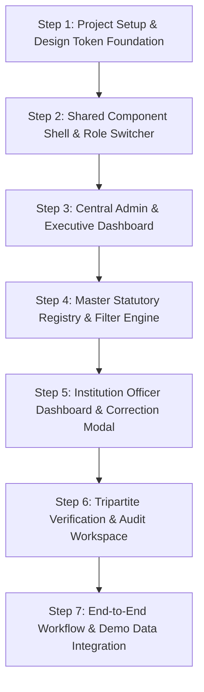

# AICTE FDR Management Portal — Build Plan (24-Hour Prototype)

This build plan outlines the implementation steps to convert the exported Stitch UI designs into a functional prototype for the **AICTE Fixed Deposit Receipt (FDR) Management Portal**.

---

## 1. Design & Screen Inspection Summary

### 1.1 Design System Foundations (`institutional_assurance/DESIGN.md`)
* **Design Philosophy:** Precision SaaS Modernism — high-density data legibility, authoritative slate/navy paired with clinical teal (`#00685f`), statutory warning amber (`#825100`), and semantic rose (`#ba1a1a`).
* **Surfaces & Elevation:** Canvas `#F8F9FF` / `#F8FAFC`, crisp white cards `#FFFFFF`, subtle borders `1px solid #E2E8F0` / `#DCE9FF`, and soft drop-shadows.
* **Typography:**
  * Headers & Brand: **Plus Jakarta Sans** (weights 600, 700).
  * Data Grids, Metadata, Body: **Inter** (weights 400, 500, 600).
  * Financials & Codes: Tabular alignment with tabular numerals (`data-mono`).
* **Icons:** Google **Material Symbols Outlined**.

---

### 1.2 Exported Screens & Role Mapping

| Screen / Artifact Directory | Screen Name & Primary Purpose | Target Roles | Key Layout & Interactive Components |
|---|---|---|---|
| `aicte_fdr_security_deposit_dashboard` & `...refined_dashboard` | **Institutional FDR Monitoring & Custody Portal (HQ Command)** | **AICTE Admin**, **Approving Authority** | • Fixed 72px sidebar + 64px glass header. • 4 Metric cards with mini arc gauges & YoY delta. • 6-Month Maturity & Encashment SVG column chart (hatched fills). • Urgent Compliance Alerts (4 cards with Form D-3 action). • Verification Queue Ledger (Pending, Renewals, Releases tabs). • Live Custody Audit Trail timeline. |
| `aicte_fdr_registry_statutory_financial_custody` | **FDR Master Statutory Registry** | **AICTE Admin**, **Verification Officer**, **Approving Authority** | • Master multi-institution tabular ledger (14,820 records). • Multi-dimensional filter console (Search ⌘K, Region, Bank, Status). • 4 Summary KPI counters (Total, Active Liens, Queue, Maturing Q3). • Checkbox bulk selection, sort dropdown, column visibility toggle. • Full pagination controls (rows per page, numbered pages, jump-to). • Row action: "View" deep-link to Instrument Audit Screen. |
| `aicte_fdr_portal_institution_dashboard` | **Institution Security Deposit & FDR Portfolio** | **Institution Officer** *(e.g., St. Xavier's Eng. College, PID: 1-10928374)* | • Dedicated institution sidebar navigation. • Urgent Scrutiny Correction banner with countdown & dismiss. • 4 KPI cards (Portfolio FDRs, Active Liens, Expiring Horizon, Scrutiny). • Filterable FDR table (All, Active, Pending Clarification, Renewals Due). • Statutory Reserve compliance progress bars. • Upcoming Deadlines list & Compliance Calendar sync. • Statutory templates download (Form D-1, Form L-1, BG format). • Scrutiny Remarks & Deficiencies Modal and FDR Details Modal. |
| `aicte_fdr_details_verification_instrument_audit` | **FDR Verification & Tripartite Audit Workspace** | **Verification Officer**, **Approving Authority** | • Breadcrumb & Instrument Metadata ribbon. • Action buttons: "Reject Instrument", "Request Clarification", "Verify & Endorse Lien". • 4 Micro-metric cards (Principal ₹1.00 Cr, Bank PNB, Lien Category, Tenor timeline). • Discrepancy Callout banner (Regional descriptor advisory). • 3-Way Cross-Audit table (Institute vs OCR vs Bank API match). • High-resolution digital instrument viewer with OCR toggle & zoom. • Reviewer Adjudication console (pre-approved snippets, compliance checkboxes, DSC sign-off). • Institutional standing profile & 5-stage chronological audit trail. |

---

## 2. Shared Components & Navigation Architecture

### 2.1 Shared UI Components
1. **Application Shell:**
   * Responsive collapsible sidebar with active module indicators and role badge.
   * Top navigation bar with global quick search (⌘K), FY switcher (2024–2025), notification bell counter, and current user avatar.
   * Universal Role Switcher in header/profile area to toggle effortlessly between demo personas during hackathon evaluation.
2. **Data & Table Components:**
   * Universal Financial Data Table with sticky header, status pill badges, mono-numeric amounts, and row-level actions.
   * Filter Toolbar: Search input, faceted select dropdowns, active filter pills with dismiss buttons, and sort selectors.
   * Pagination Bar: Total counter, rows-per-page selector, and numbered page navigation.
3. **Financial Widgets:**
   * Metric KPI Cards with arc gauges, trend icons, and status indicators.
   * Timeline / Audit Trail Component with color-coded event nodes and timestamps.
   * Statutory Progress Meter: Visual progress bars displaying required vs pledged reserves.
4. **Modals & Overlays:**
   * Scrutiny Remarks / Correction Modal with deficiency highlights and upload action.
   * Digital Instrument Preview Modal with zoom, rotate, and OCR bounding-box toggle.
   * Action Confirmation Dialogs: Rejection reason prompt, clarification request form, and DSC approval confirmation.

---

## 3. Ordered Implementation Steps (24-Hour Hackathon Roadmap)

---

### Step 1: Project Setup & Design System Foundation
* **Objective:** Establish the frontend application environment, bundling setup, and core design tokens.
* **Dependencies:** None.
* **Key Tasks:**
  1. Initialize the frontend project workspace (Vite + Vanilla JS / React with Tailwind CSS configured to match `institutional_assurance/DESIGN.md`).
  2. Embed Google Fonts (`Plus Jakarta Sans`, `Inter`) and `Material Symbols Outlined`.
  3. Configure Tailwind theme extensions with the exact Stitch tokens (colors: `surface`, `primary`, `secondary`, `tertiary`, `error`; spacing; typography; border-radius).
  4. Create base CSS utilities for tabular numerals (`data-mono`) and custom scrollbars.
* **Verification Checklist:**
  - [x] Typography renders `Plus Jakarta Sans` for headings and `Inter` for data.
  - [x] Color classes (`bg-primary`, `text-on-surface`, `bg-tertiary-fixed`, etc.) match Stitch hex values.
  - [x] Material Symbols icons load cleanly without missing glyphs.

---

### Step 2: Shared Component Shell & Role Switching Architecture
* **Objective:** Build the layout shell, responsive sidebar, top navigation, and interactive demo role switcher.
* **Dependencies:** Step 1.
* **Key Tasks:**
  1. Build the fixed sidebar supporting both AICTE Admin/Officer view and Institution Officer view.
  2. Implement the top header with search bar, FY dropdown, notification popover, and profile info.
  3. Build a persistent **Role Switcher** widget offering quick toggles:
     * **AICTE Admin** (`Dr. R. K. Sridhar - HQ New Delhi`)
     * **Institution Officer** (`Dr. Anand Deshmukh - St. Xavier's Engineering College`)
     * **Verification Officer** (`Regional Scrutiny Desk - WRO Pune`)
     * **Approving Authority** (`Joint Director - Finance`)
  4. Ensure active navigation links dynamically adapt based on the selected role.
* **Verification Checklist:**
  - [x] Switching roles updates the sidebar navigation items and user badge.
  - [x] Header search and FY controls render responsively across desktop, tablet, and mobile.
  - [x] Active route indicator matches Stitch design styling.

---

### Step 3: Central Admin & Executive Monitoring Dashboard
* **Objective:** Implement the executive command dashboard (`aicte_fdr_security_deposit_dashboard` / refined view).
* **Dependencies:** Step 1, Step 2.
* **Key Tasks:**
  1. Build the 4 Top KPI cards featuring SVG arc gauges (Total FDRs ₹4,128.50 Cr, Active Liens 87.4%, Expiring Soon 418, Pending Verification 164).
  2. Implement the 6-Month Maturity & Encashment SVG column chart with hatched bar textures and bank category legend.
  3. Build the Urgent Compliance Alerts list (Apex Inst, K.R. College, etc.) with the "Issue Statutory Notice (Form D-3)" trigger.
  4. Implement the Institutional FDR Verification Ledger widget with segmented sub-tabs (`Pending (164)`, `Renewals (842)`, `Releases (39)`) and quick action buttons.
  5. Implement the live Custody Audit Trail vertical timeline.
* **Verification Checklist:**
  - [ ] KPI cards display accurate values and stylized arc gauges.
  - [ ] Hatched SVG column chart renders sharply without overflow.
  - [ ] Verification Ledger sub-tabs filter the displayed rows dynamically.
  - [ ] Notice dispatch action triggers visual toast feedback.

---

### Step 4: Master Statutory Registry & Filter Engine
* **Objective:** Implement the multi-institution registry table (`aicte_fdr_registry_statutory_financial_custody`).
* **Dependencies:** Step 1, Step 2.
* **Key Tasks:**
  1. Build the registry header with "Export Registry (XLS/PDF)" and "Add Pledged FDR" actions.
  2. Implement the 4 Summary Stat tiles (Total Registered, Active Tripartite Liens, Queue, Maturing in Q3).
  3. Build the search & filter bar with text search, AICTE Region select, Bank select, Verification Status select, active filter chips with remove triggers, and sort order.
  4. Implement the comprehensive data table with selection checkboxes, formatted currency cells, status badges, and "View" action button linking to the Instrument Audit screen.
  5. Add full client-side pagination (rows per page, page navigation, jump to page).
* **Verification Checklist:**
  - [ ] Filtering by region, bank, or status updates the visible records immediately.
  - [ ] Removing an active filter chip resets that specific filter.
  - [ ] Clicking "View" on any record opens the Instrument Verification Audit screen with matching data.
  - [ ] Table handles horizontal scrolling gracefully on smaller viewports.

---

### Step 5: Institution Officer Dashboard & Correction Modal
* **Objective:** Implement the institution-facing portal (`aicte_fdr_portal_institution_dashboard`).
* **Dependencies:** Step 1, Step 2.
* **Key Tasks:**
  1. Render the institutional context banner for St. Xavier's Engineering College (PID: 1-10928374).
  2. Build the Urgent Notice Banner for WRO Scrutiny Correction (`FDR-PNB-883921`) with countdown and dismiss handler.
  3. Build the 4 Institution KPI cards (Portfolio FDRs, Active Liens, Expiring Horizon, Pending Resubmission).
  4. Implement the "My Pledged FDRs" table with instant search and category filter pills (`All`, `Active`, `Pending Clarification`, `Renewals Due`).
  5. Implement the Statutory Collateral Compliance breakdown cards with visual progress bars.
  6. Implement the Upcoming Deadlines list, Recent Status Updates feed, and Statutory Template download cards.
  7. Implement the WRO Scrutiny Remarks & Deficiencies Modal with interactive "Proceed to Correction Upload" action.
* **Verification Checklist:**
  - [ ] Filter pills filter the institution's FDRs correctly.
  - [ ] Clicking "View Scrutiny Remarks" opens the modal with regional officer comments.
  - [ ] Statutory reserve progress bars accurately calculate 100% compliance.
  - [ ] Form templates (Form D-1, Form L-1) trigger demo downloads.

---

### Step 6: Tripartite Verification & Audit Workspace
* **Objective:** Implement the instrument deep-dive and multi-source cross-audit screen (`aicte_fdr_details_verification_instrument_audit`).
* **Dependencies:** Step 1, Step 2.
* **Key Tasks:**
  1. Implement the instrument metadata ribbon and status badges.
  2. Build the 4 micro-metric cards (Principal ₹1.00 Cr, Bank PNB FC Road, Lien Category, 5-Year Tenor timeline).
  3. Render the Discrepancy Callout banner for Regional Office descriptor omission.
  4. Build the Multi-Source Telemetry Cross-Audit Ledger table comparing Institute Submission vs OCR Extraction vs Bank Core/PFMS API with MATCH and ADVISORY pills.
  5. Implement the Scanned Digital Instrument Viewer with simulated watermarked bond paper, digital co-sign seals, and zoom/OCR toggle controls.
  6. Build the Reviewer Adjudication Console with remarks textarea, pre-approved snippet insertion chips, statutory checkboxes, and action execution buttons ("Approve & Apply Digital DSC Signature", "Return to Trust with Remarks", "Reject Instrument").
  7. Build the Institutional Standing profile and 5-stage vertical Instrument Custody Trail.
* **Verification Checklist:**
  - [ ] Cross-audit table renders distinct comparison columns with correct badge highlights.
  - [ ] Clicking pre-approved snippet chips appends text into the remarks textarea.
  - [ ] Digital instrument preview renders cleanly with realistic certificate typography and stamps.
  - [ ] Adjudication buttons trigger state transitions (Verified, Returned for Correction, Rejected).

---

### Step 7: End-to-End Workflow & Demo Simulation Integration
* **Objective:** Connect the screens into a cohesive interactive flow demonstrating the full FDR lifecycle.
* **Dependencies:** Steps 3 through 6.
* **Key Tasks:**
  1. Wire the primary lifecycle transitions defined in `REQUIREMENTS.md`:
     * **Correction Flow:** Institution Officer sees WRO notice → reviews scrutiny remarks → submits correction → Verification Officer reviews cross-audit diffs → Approving Authority signs with DSC → status updates to Active.
     * **Renewal Flow:** Maturing alert triggers → renewal requested → OCR cross-check verified → approved.
     * **Release/Refund Flow:** Institution requests refund → verification review → approval recorded.
  2. Persist mock state in browser memory (or `localStorage`) so status updates made in one role reflect immediately when switching to another role.
  3. Ensure seamless breadcrumb and inter-screen navigation between Dashboard, Registry, Institution View, and Audit View.
  4. Perform final responsive QA and verification against the Stitch visual exports.
* **Verification Checklist:**
  - [ ] Full end-to-end demo can be performed live without page errors or broken layouts.
  - [ ] State updates persist across role switches (e.g., approving an FDR in Approving Authority reflects as Active in Institution Dashboard).
  - [ ] All 4 roles can perform their authorized actions without dead ends.
  - [ ] Aesthetics, colors, typography, spacing, and cards strictly match the exported Stitch reference designs.
